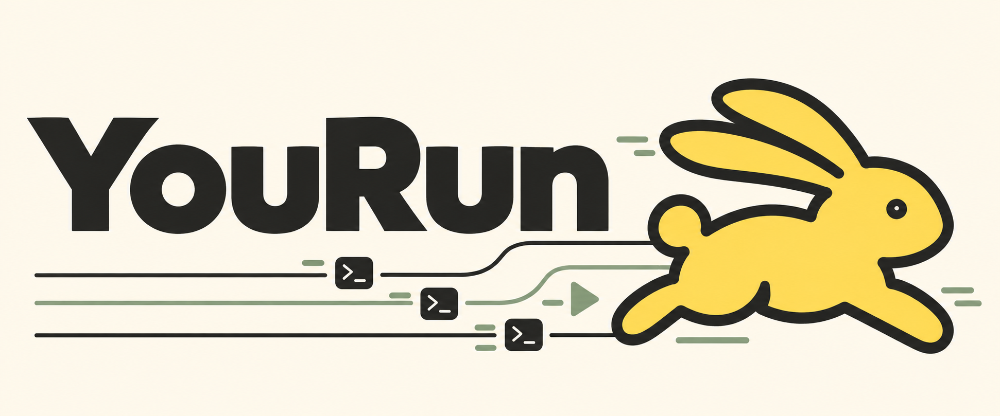
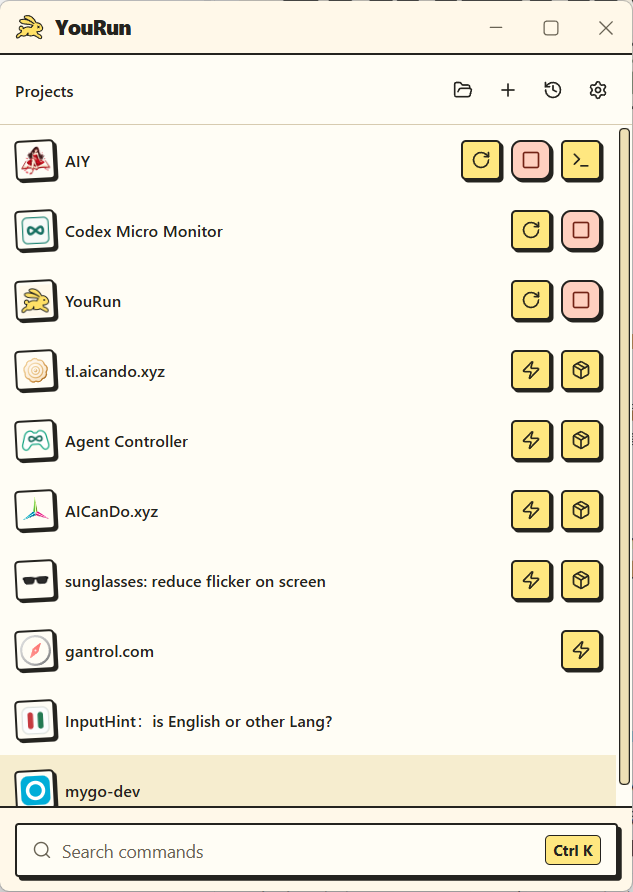

[](README.md)[](LICENSE)

[](https://apps.microsoft.com/store/detail/9MWXXGC8H67D?cid=DevShareMCLPCS)

基于[MyGo](https://github.com/egoist/mygo)，做出YouRun。集中管理各种项目的开发、运行与打包，用户或Agent可以在一个地方启动、停止、查看输出。即使YouRun被关闭或异常退出，已启动的命令仍可以独立运行。


- 以前编程重度依赖IDE、编辑器，用它们直接运行很方便，现在AI编程不太需要了，多个窗口有点累赘；
- 或许有人直接让Agent运行，但Agent更新、电脑重启等会有较大影响。

目前以 Windows 的 MyGo WebView 版为主要发行版本。

## 窗口可以关，命令继续跑


运行中的命令由独立执行进程管理。关闭 YouRun 时，可以选择“保留并退出”，也可以停止运行后退出；再次打开窗口可继续查看已有运行。

## 开始使用

1. 打开 YouRun，导入项目目录，选择要保存的命令；也可以手动添加项目和命令。
2. 确认命令文本、工作目录及环境变量。目录扫描只做静态发现，不会自动执行项目脚本。
3. 启动命令，在运行记录中查看状态和输出，按需停止或重启。
4. 将常用命令加入命令集，或直接搜索项目与命令。

运行命令所需的 Node.js、Python、Go 等工具由项目决定，需要在本机另行安装。YouRun 的输出面板用于查看日志，目前不提供交互式终端或标准输入。

## 给脚本和 Agent 的 CLI

GUI 与 CLI 共用 `YouRun.exe`。Windows 构建产物附带 `yourun.cmd`（内部调用 `YouRun.exe cli <子命令>`），由它等待主程序并返回退出码；请将两者放在同一目录。将两者复制到固定目录并将该目录加入 `PATH`，即可在任意目录直接调用 `yourun`。

下面的示例在构建输出目录的 PowerShell 中执行。假设已在界面中保存名为 `Demo` 的项目及其 `npm run dev` 命令：

```powershell
# 查找已保存的项目和命令（也可简写为 .\yourun.cmd search Demo）
.\yourun.cmd search --query Demo

# 为这次运行指定唯一 ID，便于后续查询和停止
$runId = "demo-dev-" + [guid]::NewGuid().ToString("N")
.\yourun.cmd dev --project Demo --id $runId

# 查看状态与输出
.\yourun.cmd status --id $runId
.\yourun.cmd logs --id $runId

# 停止这次运行
.\yourun.cmd stop --id $runId
```

常用入口：

| 命令 | 用途 |
| --- | --- |
| `search` | 查找已保存的项目、命令集和命令，支持 `--query` 或直接传位置参数 |
| `run` / `dev` / `start` | 选择并启动已保存的命令，支持按 `--project`、`--directory` 或 `--command` 定位 |
| `status` / `list` / `activity` | 查询状态、执行记录和活动 |
| `logs` | 读取指定运行的日志，支持游标和读取长度 |
| `stop` / `stop-all` | 停止指定运行（支持 `--id`、`--command`、`--project`、`--directory`）或全部可管理的运行 |
| `restart` | 根据已有运行重新启动 |
| `wait` | 等待运行结束，可设置 `--timeout` 超时 |
| `discover` / `inspect` | 扫描目录，查看发现结果，不保存配置 |

CLI 的查询和操作结果使用 JSON。退出码语义：`0` 成功或已接受、`1` 任务失败或已停止、`2` 请求或参数错误、`3` 执行结果未知、`124` `wait` 等待超时。

命令定义通过界面保存；CLI 不提供直接执行任意命令文本、写入项目配置或交互式 Shell 的入口。完整参数可查看：

```powershell
.\yourun.cmd --help
```

## 从源码构建

以下步骤针对 Windows x64 的 MyGo WebView 版。准备 Node.js、npm 和 Go 工具链（构建脚本已配置 `GOTOOLCHAIN=go1.27.2+auto`，会自动匹配 Go `1.27.2`）。运行 GUI 还需要 Microsoft Edge WebView2 Runtime。

在本应用目录执行：

```powershell
npm --prefix frontend ci --ignore-scripts --no-audit --no-fund
node build.mjs --framework=mygo
```

构建过程会执行前端类型检查、打包和 Go 编译。产物位于：

```text
dist/builds/<构建编号>/windows-amd64/
├── YouRun.exe
├── yourun.cmd
├── LICENSE
├── THIRD-PARTY-NOTICES.txt
└── THIRD-PARTY-LICENSES.txt
```

准备 0.1.1 发行候选时，执行 `node build.mjs --framework=mygo --release=true`，产物按版本归档到 `dist/releases/0.1.1/portable/windows-amd64/`。加上 `--package=msix --msix-config=packaging/windows/msix.store.json` 可生成 Store 候选包，位于 `dist/releases/0.1.1/msix/windows-amd64/msix-mygo/`，需要 Windows SDK。已有程序不会被覆盖；版本目录中的 `PUBLISHED` 文件会阻止该版本再次进行 release 构建。

双击 `YouRun.exe` 打开窗口。开发时可在应用目录运行 `.\run.ps1`，脚本会按需安装前端依赖、构建前端并默认使用 MyGo WebView 启动。

## 当前范围

- **Windows**：主要发行目标。待发布的 Microsoft Store 包面向 Windows 11（内部版本 22000 或更高）的 x64 设备，需要 WebView2 Runtime。
- **自启动**：Windows 非打包版本可在设置中控制开机自启动；当前 Microsoft Store 包暂未提供该能力。
- **其他平台**：源码保留其他平台与窗口框架的构建入口，暂时不是已验证的发行版本。

## 数据与隐私

项目、命令定义、运行记录和日志保存在本机。Windows 非打包版本默认使用 `%APPDATA%\command-manager`；可通过 `COMMAND_MANAGER_HOME` 指定数据目录。MSIX 包中的实际位置由 Windows 的应用数据管理机制决定。

YouRun 不要求注册账户，也不提供云同步。由 YouRun 启动的项目工具仍会按各自的配置访问网络。保存的环境变量和输出日志可能含有敏感信息，分享前请检查内容。

## 许可证

代码使用 [Apache License 2.0](LICENSE)。第三方依赖说明见 [THIRD-PARTY-NOTICES.txt](THIRD-PARTY-NOTICES.txt)。
