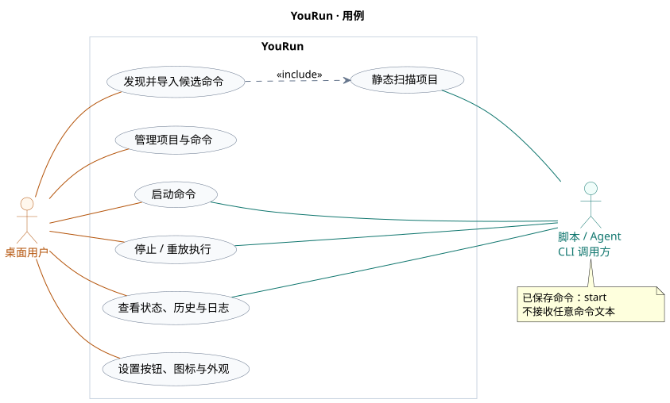
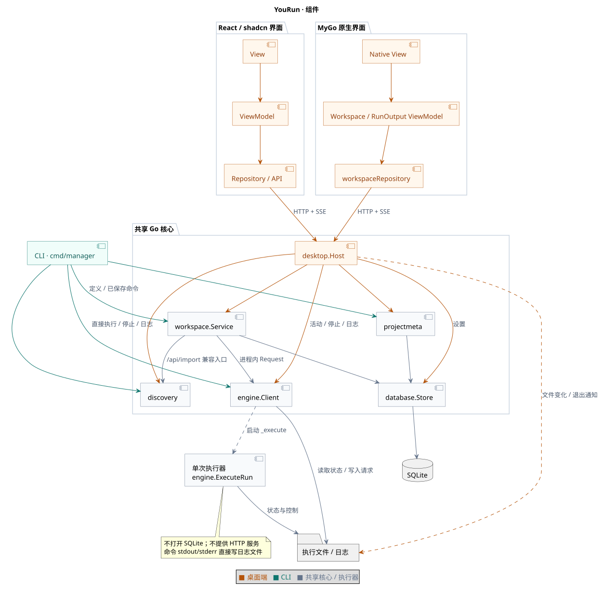
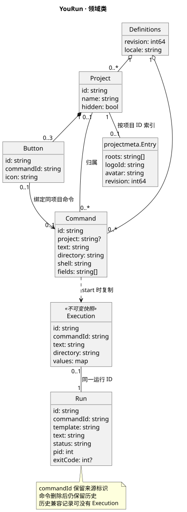
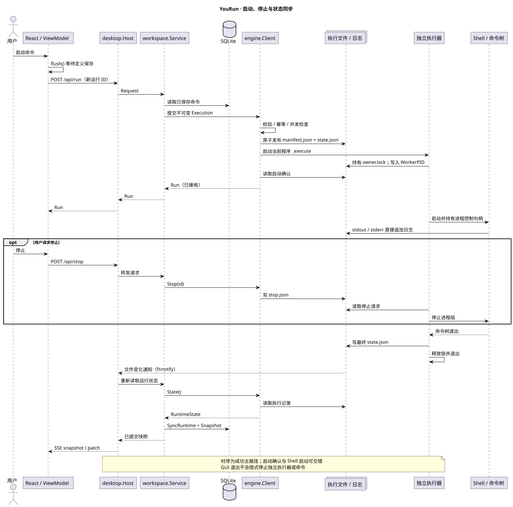
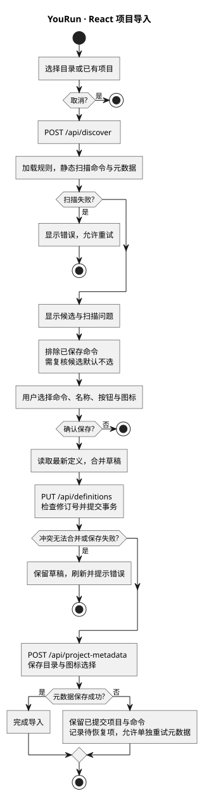
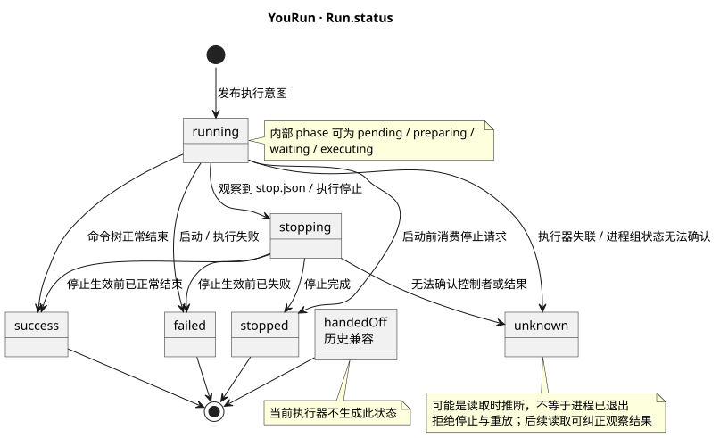
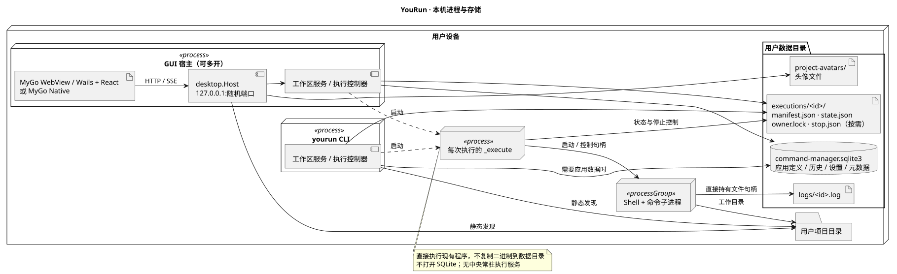

# YouRun 项目 UML 简析

核对日期：2026-10-14。依据当前工作区源码，描述已实现的结构与行为；图中省略次要字段和平台细节。

YouRun 是本地项目与命令管理工具。桌面端以 **MyGo WebView + React 前端**为基础（`mygo-native` 已停止维护），同时提供非交互 CLI。应用数据存入 SQLite，每次执行由独立进程管理，界面与命令的生命周期分离。

| UML 视图 | 回答的问题 | 可编辑源文件 |
| --- | --- | --- |
| [用例图](#用例图) | 谁使用哪些能力？ | [use-cases.puml](diagrams/use-cases.puml) |
| [组件图](#组件图) | 模块如何分工？ | [components.puml](diagrams/components.puml) |
| [类图](#类图) | 项目、命令与执行如何关联？ | [domain.puml](diagrams/domain.puml) |
| [时序图](#时序图) | 一条命令如何启动、停止并同步？ | [execution-sequence.puml](diagrams/execution-sequence.puml) |
| [活动图](#活动图) | 发现和导入项目有哪些分支？ | [import-activity.puml](diagrams/import-activity.puml) |
| [状态图](#状态图) | 运行状态如何变化？ | [run-states.puml](diagrams/run-states.puml) |
| [部署图](#部署图) | 进程和存储部署在哪里？ | [deployment.puml](diagrams/deployment.puml) |

## 用例图

桌面用户及其连线使用橙色，CLI 调用方及其连线使用青绿色；两类参与者分列左右。



用户通过桌面端管理项目、命令、启动按钮、命令集及运行记录；脚本或 Agent 通过 CLI 调用静态发现、搜索、启动已保存命令、停止与日志能力。CLI 不提供导入或保存定义的入口，也不接受任意命令文本；`start`、`run` 和 `dev` 均读取已保存命令。扫描仅产生候选，导入与保存通过桌面端完成，不会自动执行命令。（CLI 范围于 2026-10-16 复核。）

源码：[桌面入口](../frontend/src/app.tsx)、[CLI 入口](../cmd/manager/main.go)。

## 组件图

橙色表示桌面端组件与调用，青绿色表示 CLI 组件与调用，灰色表示共享核心与执行器之间的依赖。



React 前端采用 View → ViewModel → Repository 分层，由 MyGo WebView 承载并复用 `desktop.Host`（`mygo-native` 原生端已停止维护，不再参与默认构建）。工作区服务负责命令定义、修订检查与运行历史同步；`engine.Client` 是进程内控制器。CLI 直接调用 Go 库，无需连接桌面 HTTP 服务。

React 前端通过 `/api/events` 和 `/api/log-events` 接收 SSE 快照、增量及日志；宿主将文件变化与执行器退出事件转换为重新读取已提交数据的信号。`SyncRuntime` 先通过只读查询比对观察游标与运行快照，快照未变时不开启写事务，避免无谓 WAL 写入与自触发事件。

源码：[React ViewModel](../frontend/src/viewmodels/workspace-view-model.ts)、[React Repository](../frontend/src/repositories/workspace-repository.ts)、[MyGo 宿主入口](../mygo/main.go)、[Host](../desktop/host.go)、[事件流](../desktop/events.go)、[工作区服务](../internal/workspace/service.go)。

## 类图



项目聚合启动按钮，命令可不属于项目。按钮最多三个，可留空或绑定同项目的命令。`Execution` 保存一次提交的命令快照，`Run` 保存执行结果；命令修改或删除后，运行历史仍保留。图中的关联是领域关系，不表示数据库外键或级联删除。

`Project`、`Command`、`Run`、项目元数据与设置在 SQLite 中保存；按钮、字段及参数集合使用 JSON 列。运行中的事实来自执行文件，工作区服务将变化同步为数据库历史。定义保存采用修订号检查，React 保存队列合并未冲突字段，同字段冲突拒绝覆盖。

源码：[领域结构与校验](../internal/engine/model.go)、[表结构](../internal/database/tables.go)、[运行同步](../internal/database/runtime.go)、[元数据](../internal/projectmeta/store.go)、[字段合并](../frontend/src/models/workspace.ts)。

## 时序图



图示 React 启动已保存命令的主路径。界面先等待保存完成，服务端再读取命令并生成快照。控制器用运行 ID 去重、检查活动命令及并发上限，原子发布执行目录，启动当前程序的 `_execute` 模式。启动确认超时不代表任务未启动，应读取同一运行 ID 的状态。

停止请求写入 `stop.json`，由持有控制句柄的执行器终止进程组。命令的标准输出与错误直接写日志文件；执行器结束时写最终状态。宿主关闭不会隐式停止任务。

源码：[运行 ViewModel](../frontend/src/viewmodels/use-run-view-model.ts)、[快照转换](../internal/workspace/service.go)、[启动与停止](../internal/engine/client.go)、[执行器](../internal/engine/worker.go)、[日志事件](../desktop/events.go)。

## 活动图



图示 React 导入流程。发现模块按规则静态读取项目文件，限制扫描目录、读取量和候选数量。界面排除已保存命令，需复核的候选默认不勾选；用户确认后先保存定义，再保存目录与图标元数据。第二步失败时保留已保存的命令，可单独重试元数据，因此导入包含两个提交阶段。

源码：[发现规则](../internal/discovery/registry.go)、[扫描器](../internal/discovery/scan.go)、[预览接口](../desktop/discovery.go)、[导入界面](../frontend/src/project-import.tsx)、[导入保存](../frontend/src/viewmodels/use-workspace-view-model.ts)。

## 状态图



图中采用对外的 `Run.status`，内部 `phase` 另有 `pending`、`preparing`、`waiting`、`executing`、`finished`。所以 `running` 也包含尚在准备或等待前次执行结束的阶段。

`unknown` 表示无法确认执行结果，不能据此断言命令已退出；停止和重放都会拒绝接管这类记录。`stopping` 也可能只是读取到了停止请求，任务若抢先自然结束，仍可能显示 `success` 或 `failed`。重放创建新的运行 ID，使用原快照及环境，等待前次结束后启动；旧记录不会回到 `running`。`handedOff` 仅保留历史兼容，当前执行器没有生成它的路径。

源码：[状态读取与重放](../internal/engine/client.go)、[执行状态写入](../internal/engine/worker.go)、[前端状态类型](../frontend/src/model.ts)。

## 部署图



各 GUI 宿主与 CLI 共享同一用户的数据目录：优先使用 `COMMAND_MANAGER_HOME`，否则使用系统用户配置目录下的 `command-manager`。每个 GUI 宿主监听独立的 `127.0.0.1` 随机端口，普通 API 校验 Bearer token、Host 和 Origin。执行器不打开 SQLite，也不启动 HTTP 服务。

Windows 使用 Job Object，Unix 使用进程组管理命令树。执行器与命令均可独立于 GUI 存活，命令持有自己的日志文件句柄。当前执行器直接使用已安装程序，没有额外复制到数据目录的步骤。更新模块仍保留在源码中，但 `applicationUpdatesEnabled = false`，因此图中不包含在线更新服务。

源码：[数据目录](../internal/engine/storage.go)、[执行程序选择](../internal/engine/install.go)、[Windows 进程控制](../internal/engine/process_windows.go)、[Unix 进程控制](../internal/engine/process_unix.go)、[更新开关](../desktop/updates.go)。

## 图表维护

`diagrams/` 同时保存 PlantUML 源文件和 SVG，Markdown 可直接显示图片。修改 `.puml` 后使用本地 PlantUML 重新生成。用例图和组件图使用 Graphviz 布局以控制间距与连线，其余源文件沿用内置 Smetana 布局。生成示例（在仓库根目录执行，将 JAR 路径替换为本机路径；`-testdot` 可检查 Graphviz 是否可用）：

```powershell
java '-Djava.awt.headless=true' -jar C:/tools/plantuml.jar -charset UTF-8 -tsvg docs/diagrams/*.puml
```
